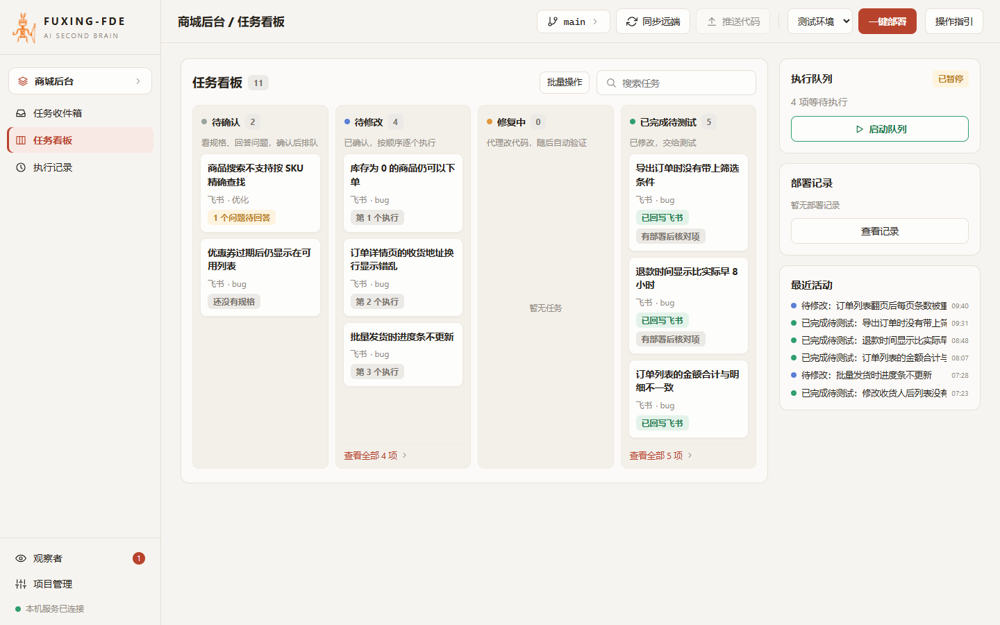
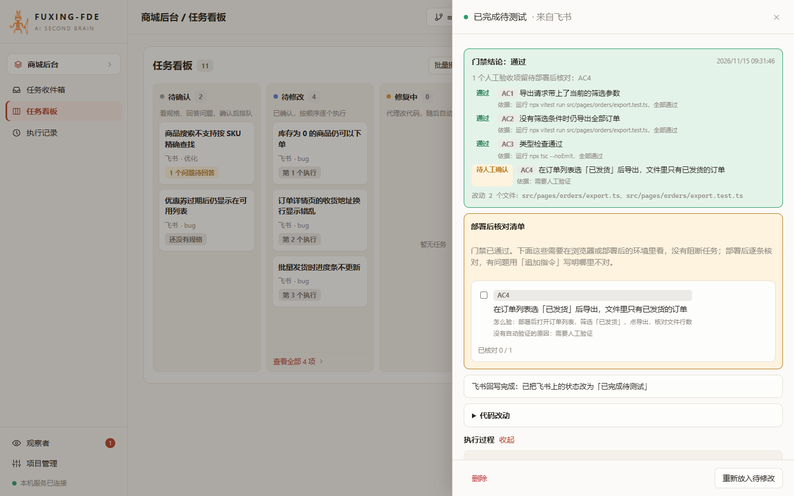
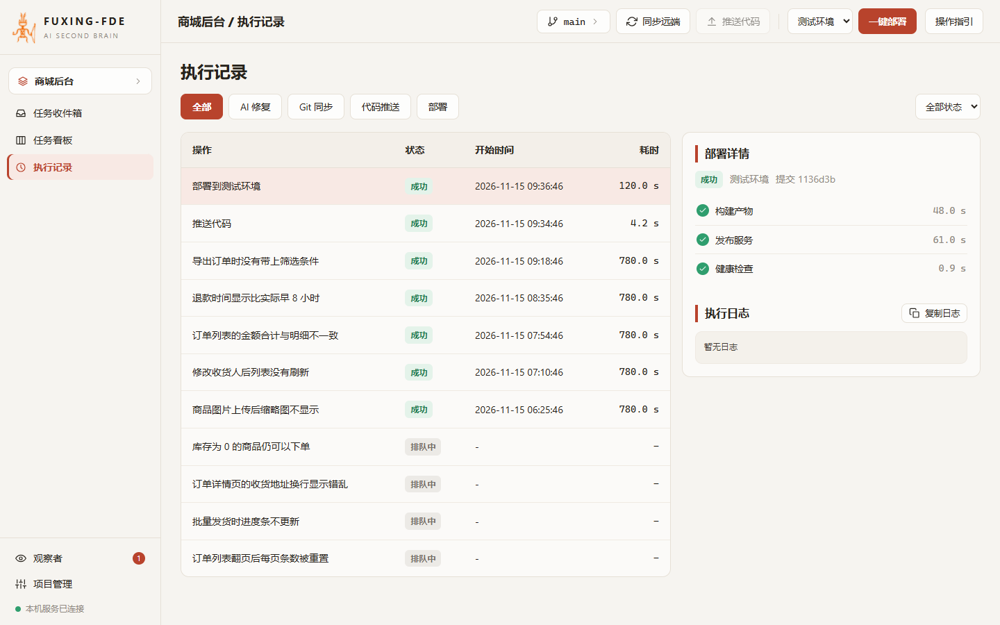
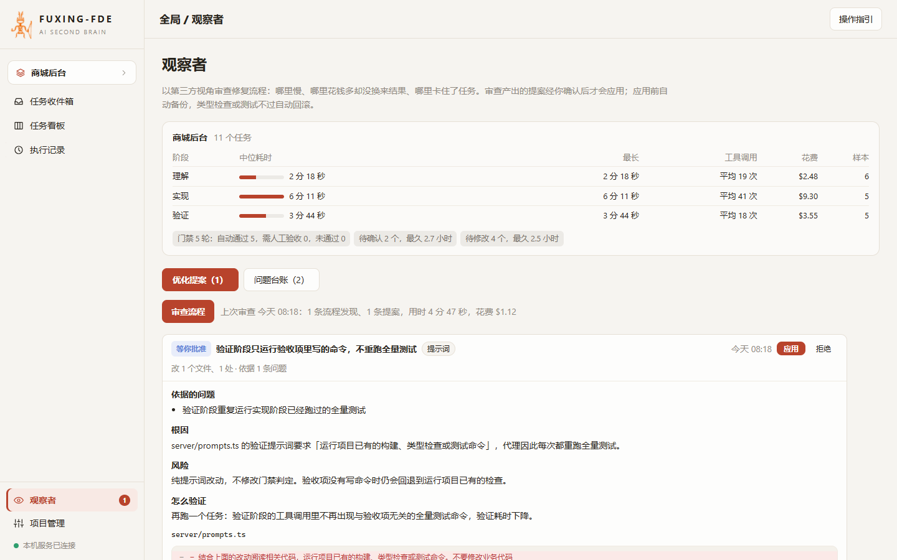
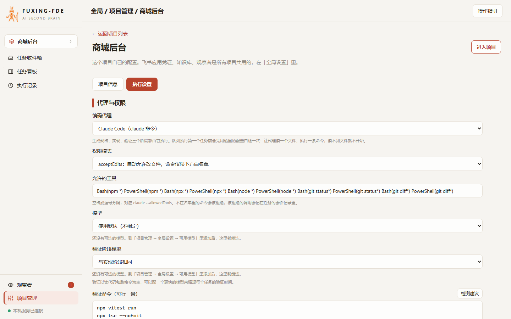

# claude-task-workspace

把飞书多维表格里的缺陷任务导入本地看板，交给编码代理（Claude Code 或 Codex CLI）逐个修复、自动验证，通过后把飞书上的状态改成「已完成待测试」。

只在本机运行：服务只监听 `127.0.0.1`，没有登录鉴权，不要暴露到网络上。



## 流程

```
飞书「待修改」 → 待确认 → 待修改（排队） → 修复中（改代码 + 自动验证） → 已完成（回写飞书）
```

- **待确认**：代理先读代码，写出一份规格（目标、根因、改动范围、验收项）。你确认后才会动代码。
- **待修改**：已确认的任务按顺序排队。同一个项目一次只执行一个，前一个结束才取下一个。
- **修复中**：代理按规格改代码，随后逐项验证验收项。
- **门禁**：结论由事实决定（有没有改动、改动是否超出范围、验收项的验证结果），不采信代理的自述。
- **待验证 / 异常**：自动验证没验到的、没跑通的任务才会出现在这两列，平时隐藏。

进入下一步可以手动（点确认或拖动卡片）、自动（规格生成后自动确认、有任务就自动开工）或定时（每天到点启动队列）。

## 截图

截图里的项目和任务都是演示数据。

**任务详情**：门禁结论逐项列出验收项的验证结果和依据；需要人工看的项列为部署后的核对清单，不阻断流转。



**执行记录**：每次修复、推送、部署的步骤与耗时。



**观察者**：各阶段的耗时与花费，以及对本工具自身的优化提案（改哪个文件、依据什么问题、改动前后对比）。



**执行设置**：每个项目单独配置编码代理、权限、验证命令和流转方式。



## 功能

- **任务看板与收件箱**：导入、查看规格、确认、追加指令、查看本次改动的 diff。
- **执行记录**：每次修复、Git 同步、推送、部署的步骤与耗时。
- **项目管理**：每个项目的代码目录、飞书来源、Git 仓库、部署环境、执行设置；以及所有项目共用的全局设置。
- **观察者**：统计各阶段耗时与花费、门禁结论、任务积压，审查流程并给出对本工具自身的优化提案；提案经你确认后才应用，应用前备份，检查不过自动回滚。
- **Skill 库**：指定一个目录，其中 `.claude/skills` 下的 skill 对所有项目的代理可用。

## 环境要求

- Node.js 22（开发与测试使用的版本）
- git
- 至少一种编码代理的命令行：[Claude Code](https://claude.com/claude-code)（`claude`）或 Codex CLI（`codex`），也可以配置任意本地命令行代理
- 一个飞书自建应用（App ID 与 App Secret），需要有读取、回写目标多维表格的权限

## 开始使用

```bash
npm install
npm run dev
```

打开 <http://127.0.0.1:5173>。前端开发服务在 5173，后端在 5174（可用环境变量 `PORT` 修改）。

首次使用按这个顺序配置：

1. **项目管理 → 全局设置**：填写飞书应用的 App ID 与 App Secret。
2. **项目管理 → 添加项目**：填项目名称和本机的代码目录。代码目录需要是 git 仓库，系统才能核对每个任务改了哪些文件。
3. **项目管理 → 配置 → 项目信息**：填飞书多维表格的链接，以及要导入的状态取值。
4. **项目管理 → 配置 → 执行设置**：选择编码代理，按需填写验证命令、花费上限和流转方式。
5. 回到任务收件箱，同步飞书任务，确认规格后启动队列。

## 常用命令

| 命令 | 作用 |
|---|---|
| `npm run dev` | 启动前后端开发服务 |
| `npm run build` | 构建前端到 `dist/client` |
| `npm start` | 只启动后端；已构建时同时提供前端页面 |
| `npm test` | 运行测试 |
| `npm run typecheck` | 类型检查 |

## 数据与凭据

所有运行数据都在项目根目录的 `data/` 下：任务、项目配置、执行记录，以及飞书应用密钥和 Git 凭据。这个目录已在 `.gitignore` 里，不要提交，也不要分享。

## 目录结构

```
server/   后端：队列、代理调用、门禁、飞书读写、Git 与部署、观察者
client/   前端：React 页面
data/     运行数据（不进仓库）
```

## 注意事项

- 代理会真实修改你配置的代码目录。开启自动提交时，门禁未判失败的改动会在本地提交，不会推送。
- 开启飞书回写后，任务流转会修改飞书表格里对应记录的状态。
- 同时开启「自动确认」和「自动开工」时，从导入到改代码全程没有人工确认。
- 观察者应用提案时会修改本工具自己的 `server/` 与 `client/` 代码。
